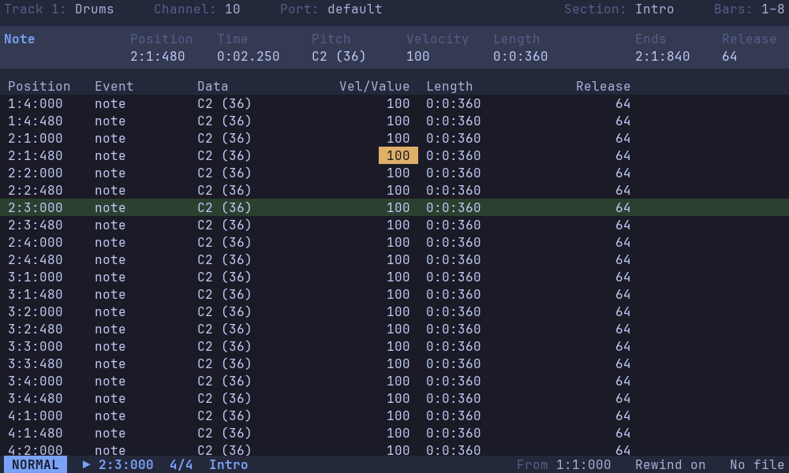

# Modal

Modal is a fast, keyboard-driven MIDI sequencer for Linux and Windows, inspired by Voyetra Sequencer Plus Gold. It's a GUI program drawn on a fixed character grid, like a terminal, with Vim-like modal editing. It's MIDI only: no audio tracks.

## Status

Early: it plays, opens, edits and saves songs, but it isn't yet ready for making music. Built so far:

1. **Engine and MIDI layer:** playing Standard MIDI Files with timing measured on real hardware.
2. **Recording:** with metronome, count-in and pre-roll (from the command line, for now).
3. **Grid renderer:** the window, font and grid, keys and key bindings, settings and themes, and a `:` prompt.
4. **The event list,** the first real view. Songs made of sections, opened, saved and exported in a plain-text format or as MIDI files, with undo; Vim-style motions and operators; editing events in place; an inspector; and playback from a play-from marker.



Next come the piano roll and arrangement views (milestone 5), then Visual mode, transforms, search and the command palette across all three views (milestone 6). The plan for the rest is in [docs/design.md](docs/design.md).

## Building

Modal is C++20, built with CMake 3.25 or later, with its libraries from [vcpkg](https://vcpkg.io) in manifest mode. Set `VCPKG_ROOT` to a vcpkg clone, then use a preset: `windows-msvc` on Windows; `linux-gcc` or `linux-clang` on Linux.

```
cmake --preset windows-msvc
cmake --build --preset windows-msvc-release
ctest --preset windows-msvc-release
```

On Linux, vcpkg also needs Ninja, `pkg-config`, autotools (`autoconf autoconf-archive automake libtool`) and the X11 and Wayland development packages (`libx11-dev libxext-dev libwayland-dev libxkbcommon-dev libegl1-mesa-dev`), and MIDI needs the ALSA runtime (`libasound2t64`).

## Running

The programs are in `build/<preset>/apps/Release` (or `Debug`):

- `modal` is the GUI.
- `modal-ports`, `modal-play`, `modal-record` and `modal-loopback` list MIDI ports, play and record MIDI files, and measure timing. See [docs/tools.md](docs/tools.md).

### The arrangement

Modal opens in the arrangement: a row for each track, its bars drawn as blocks shaded by how busy they are, under a ruler of sections, meters and bar numbers. The cursor is a bar of a track: `h` `l` move by bars, `j` `k` between tracks, `gg` `G` (or `0` `$`) to the first and last bar, `]s` `[s` to sections, `zi` `zo` `z0` zoom, and Enter opens the bar in the event list. `d` and `y` take bars as Vim's operators take text: `dd` (or `x`) deletes the events starting in the cursor's bar, `3dd` in three bars, `d2l` this bar and the next, `dG` to the end, and `dj` the cursor's bar on this track and the next; `p` puts what was yanked or deleted at the start of the cursor's bar.

Above the tracks is the section strip: `gs` (or `k` from the first track) goes to it, and `j` back. There `h` `l` go between sections; `x`, `dd`, `yy` (or `Y`), `p` and `P` delete, yank and put whole sections, before or after; `Alt-h` `Alt-l` move one; `J` joins it with the next; `+` `-` lengthen and shorten it by a bar; `i` `a` insert a new one; `c` renames it; and Enter plays from it. `ge` shows the event list at the cursor, `ga` the arrangement, and Backspace goes back to the view before.

### The event list

`modal FILE` opens a song (`.modal`) or imports a MIDI file (`.mid`), and the event list shows it one track at a time; plain `modal` starts a new song, and `modal --demo` opens a made-up demo song. `:w` saves, `:e FILE` opens, `:export FILE.mid` exports a MIDI file and `:q` quits, as in Vim; closing the window with changes not saved asks whether to save them. Each event is a row, with its fields in columns. The conductor's section starts, meters, tempos and markers are shown dimmed among a track's events, to find the way by; they're edited in the conductor's own list, track 0.

| Keys | What they do |
|------|--------------|
| `j` `k`, `h` `l`, arrow keys | Move between events and fields, with counts such as `12j` |
| `0` `$`, Home End | First and last field |
| `gg` `G` | First event and the end; with a count, that bar |
| `w` `b`, `}` `{`, `]]` `[[` | The event at or after the next or previous beat, the same place a bar on or back, or a bar line |
| `)` `(` | The next or previous chord: events within 30 ms of each other (`set chordwindow`) |
| `]s` `[s`, `]m` `[m` | The next or previous section's start, or marker |
| `d` `y` with a motion, `dd` `yy` | Delete or yank events: `dj` this event and the next, `d}` up to where `}` goes |
| `x`, `p` | Delete this event; put what was yanked or deleted at the cursor's time |
| Enter | Edit the field under the cursor: type a value, or a change such as `+10` or `+1/16` |
| `+` `-`, `Ctrl-A` `Ctrl-X` | Step the field up or down, with counts |
| `o` | Add a note at the cursor's time, typing its pitch |
| `u` `Ctrl-R` | Undo and redo, going back to where the change was made |
| `gt` `gT` | Next and previous track, the conductor as track 0; `3gt` goes to track 3 |
| Ctrl with `j` `k` or the arrows | Move, scrolling so the cursor stays in place on screen |
| `Ctrl-D` `Ctrl-U`, `Ctrl-F` `Ctrl-B` | Scroll half a page, or a page |
| `zz` | Centre the cursor |
| `Ctrl-+` `Ctrl--` `Ctrl-0` | Text bigger, smaller, or back to its configured size |
| Space | Play from the play-from marker (the ▶ in the margin), or stop |
| `m Space`, `Ctrl-Space` | Put the play-from marker at the cursor; or put it there and play |
| `, t Space` | Rewind on or off: whether the marker stays put when playback stops, or moves to where it stopped |
| `Ctrl-.` | Panic: stop, and All Notes Off and Reset All Controllers on every channel |
| `ga`, `ge`, Backspace | The arrangement, the event list, and back to the view before |
| `:` | The command prompt: `:set theme=light`, `:set fontsize?`, `:port loopMIDI`, `:write-config modalrc`, `:q` |

Tracks play to their own output port, or if they have none (as in an imported MIDI file) to the `port` setting's, or else the first output port found. `:section NAME` starts a new section at the cursor's bar line. `:port NAME` sets the current track's port, by its name or any part of it that matches only one port; `:port` alone says which it plays to and lists the ports. On Linux, Modal also makes a port of its own, `Modal`, for a plugin host or another program to connect to (`set ownports=4` for `Modal 1` to `Modal 4`); on Windows, a virtual cable such as loopMIDI does the same job. While playing, the list scrolls to keep the row playing a third of the way down.

## Configuring

Settings, key bindings and colours live in a Vim-style `modalrc` file. `:write-config modalrc` writes one with everything in it to start from. See [docs/configuration.md](docs/configuration.md).

## Contributing

Contributions are welcome: see [CONTRIBUTING.md](CONTRIBUTING.md), and open an issue first for anything substantial.

## Licence

Modal is free software: you can redistribute it and/or modify it under the terms of the GNU General Public License as published by the Free Software Foundation, either version 3 of the License, or (at your option) any later version. See [LICENSE](LICENSE).

Modal is distributed in the hope that it will be useful, but WITHOUT ANY WARRANTY; without even the implied warranty of MERCHANTABILITY or FITNESS FOR A PARTICULAR PURPOSE.

The libraries it's built with, and its built-in JetBrains Mono font, are under their own licences, all compatible with the GPL: see [licenses/](licenses/README.md).
