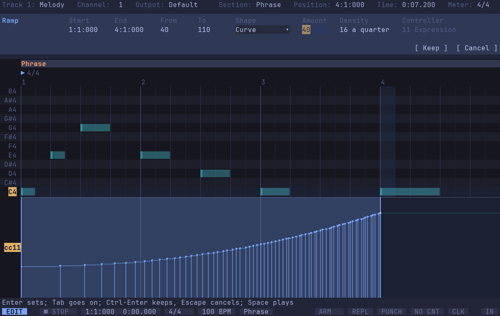

# Controllers, velocities and pedals {#sec-controllers}

Notes describe attacks and durations. Much of an instrument's phrasing lives
in the messages between them: modulation, expression, pitch bend, aftertouch
and pedals. The controller lane makes those messages visible against the
notes they affect.

There is one displayed lane at a time in this edition. It can show note
velocity, a controller, pitch bend or channel aftertouch. The lane choice
belongs to each track and is saved in the song.

## Choosing a lane and choosing its focus

`, c c` opens the lane chooser. The list includes Velocity, recently chosen
lanes, controllers present on the track and useful common choices. A name
or number narrows the list. `:lane cc74`, `:lane bend`, `:lane pressure`
and `:lane velocity` choose directly. `[c` and `]c` move between controllers
the track already contains.

Three rows are enough to see a shape, but not always to set values
precisely. `, c h`, remembered as “height”, makes the lane taller: a quarter
of the view, then half, then back to three rows. Each track keeps its own
height in the song, so a part with detailed controller work opens with the
room it needs.

Choosing what the lane displays and moving the cursor into it are separate
actions. `gl`, remembered as “go to lane”, puts the focus there. Escape returns
to the notes. The lit lane name and tinted background make the current focus
visible, because the same directions have different purposes in the notes
and in a value display.

## Velocity belongs to a note

The velocity lane draws one bar for each note. Notes starting together fan
out so their individual values remain accessible. Velocity is not an
independent event that can be moved away from its note: changing it changes
the note's attack value.

{#fig-velocity-lane fig-alt="The example melody above its velocity bars; vel is lit to show lane focus and the current note's bar is brighter than the others."}

In this lane, Tab and Shift-Tab visit the next and previous notes; Right
and Left (or `l` and `h`) provide the same forward and backward movement.
A chord's simultaneous notes are visited from low to
high pitch. Ctrl-A and Ctrl-X step velocity up and down; a number followed
by Enter sets an exact value. Enter alone asks for a value or change, such
as `100`, `+10` or `80%`.

A `v` selection follows notes between its anchor and cursor. A Ctrl-V box
restricts both note positions and velocities: it can isolate the unusually
loud notes in a passage without taking its softer accompaniment. Inside a
box, Down and Up (or `j` and `k`) change the velocity edge by one, and
Shift-Down and Shift-Up (or `J` and `K`) by ten.
`o` swaps its active corner.

When an edit moves the selected velocities outside their original band,
the selection keeps those notes until deliberately redefined. This permits
several adjustments to the same musical group. A number and Enter assigns
the same velocity to the selected notes, while steps preserve their differences.

Deletion and time movement are deliberately unavailable in the velocity
lane. They belong to the notes themselves. Returning to the piano roll
makes that broader intention explicit.

## Continuous controller values are held between events

A controller event changes a value at an instant. The receiver holds that
value until another message changes it. The lane therefore joins events
with a faint held-value line; it is not implying that the stored messages
form a continuous smooth curve.

The cursor may sit between events. The inspector then shows the held value,
which can be musically important even when there is no event at the cursor.
Pitch bend is drawn above and below its centre; ordinary controllers and
channel pressure use their own value ranges.

| Value | Range |
| --- | --- |
| Note velocity | 1 to 127 |
| Controller or channel pressure | 0 to 127 |
| Pitch bend | -8192 to +8191, with 0 at centre |

The instrument decides how a controller or bend value affects sound. A bend
value is not itself a number of semitones; the receiver's bend range matters.

| In a controller lane | Meaning |
| --- | --- |
| Tab / Shift-Tab | Visit stored events |
| Left / Right, or `h` / `l` | Move by grid steps, including empty time |
| Shift-Left / Shift-Right, or `H` / `L` | Nudge the cursor between grid lines |
| Ctrl-A / Ctrl-X | Step the current or selected values |
| Number then Enter | Set a value, or add an event at an empty position |
| Enter | Ask for an exact value or relative change |
| `o` | Add an event using the preceding value |
| `x`, or `d` with a target | Delete events |
| Alt-Left / Alt-Right, or `Alt-h` / `Alt-l` | Move events by grid steps |
| Alt-Shift-Left / Alt-Shift-Right, or `Alt-H` / `Alt-L` | Move events by a nudge |

Notice the difference from velocity: here Left and Right (or `h` and `l`)
move through **time**,
while Tab visits the events that exist. This allows a new controller value
to be placed between old ones. In the velocity lane all useful values
already belong to notes, so left and right visit those notes instead.

A controller value of zero is valid. `0` followed by Enter sets it, rather
than treating that sequence as a movement to the start. Pitch bend also
accepts negative values; the prompt identifies the value being edited.

`v` takes a time range of events and Ctrl-V a time-and-value box. The same
selection idea applies, but the vertical dimension now means value rather
than pitch. Moving or deleting data must preserve the order and validity
of the messages; an invalid batch is refused.

## Reducing dense controller data {#sec-controller-thinning}

A controller gesture can contain many more events than are needed to describe
its shape. Thin reduces that density within the selected passage, or the
cursor's bar when nothing is selected. For example, `:thin cc1 per=16 step=2`
thins modulation to events spaced at least a sixteenth of a quarter note
apart and changed by at least two value steps. Use `bend`, `aftertouch` or
`all` in place of `cc1` for the other continuous data. The leader route is
`, x d`, followed by a range or object and the settings it asks for.

Thin always keeps each gesture's first and last events and **every zero
value**, even repeated zeros. A pitch bend value of zero is its centre;
a pressure value of zero releases the pressure. Removing a return to zero
partway through a phrase could leave the instrument bent or modulated until
the next surviving event. These protected events can exceed the requested
density. A retained reset becomes the reference for spacing and value changes
after it. Events outside the target remain unchanged, and the whole edit undoes
as one step.

Pedals and other switch controllers are left alone by Thin: their changes
are actions to preserve, rather than points along a continuous curve.

## Shaping values {#sec-controller-shaping}

Sometimes the gesture is already right, but its values are too strong, too
wide or too high. Shaping changes the values of the existing events,
keeping their times. Scale changes the contour; limit trims its extremes;
invert turns a rise into a fall. Each works on the selected passage, or the
cursor's bar if there is no selection, and undoes as one step.

For example, a modulation gesture ranging from 20 to 100 can be made half
as strong with `:ctl-scale cc1 50%`: those values become 10 and 50. An
offset, `:ctl-scale cc1 +10`, raises them to 30 and 110 instead. To fit the
existing contour into particular bounds, use `:ctl-scale cc1 30-90`: its
lowest non-zero value becomes 30, its highest 90, and the intervening
values keep their proportions. Each aftertouch stream is fitted separately,
including each pitch's polyphonic aftertouch. A stream with just one distinct
non-zero value stays as it is, since it has no contour to stretch.

Scale rounds to the nearest whole value and clips anything beyond the
controller's limits. Its percentage is measured from the stream's centre:
0 for most controllers, 64 for pan and balance, and 0 for pitch bend. Thus
halving a pan gesture draws it towards the middle rather than to the left.
Percentages run from 0% to 1000%; offsets may be up to 127 either way, or
16383 for pitch bend.

Limit and invert do different jobs:

- `:ctl-limit cc1 30-90` clips values below 30 or above 90 to those limits;
  the middle of the gesture stays as it was. Its first and last values are
  clipped too. Fitting the whole contour into that range is scale's job.
- `:ctl-invert cc1` replaces each value with 127 less itself. Pitch bend is
  negated; pan and balance are mirrored about 64. At the asymmetric ends of
  those ranges the result clips: bend -8192 becomes 8191, pan 0 becomes 127.

**Scale and limit preserve every zero reset**, including bend centre, in
all their forms. Resets are left out when finding the contour's bounds for
a fit. Invert changes zeros too, since exchanging the low and high values
is its purpose. All three leave switch controllers, bank selection and
other controller actions alone. Editable ramps and the events they hide
are protected; the message says how many ramps were left alone. Convert a
ramp to ordinary events first if those events are what you want to shape.

Use `bend` or `aftertouch` in place of `cc1`. Bend takes signed ranges,
for example `:ctl-limit bend -4096-4096`. Named settings are also accepted:
`:ctl-scale cc1 by=80%` and `:ctl-limit cc1 range=30-90`.

The keyboard routes are `, c s` for scale, `, c l` for limit and `, c i`
for invert, followed by a range or object; in Visual mode the selection
already supplies it. The same tools are under `, x K`. For example,
`, c s ib` scales the cursor's bar. They ask which controller and then the
amount or range, Enter taking the lane's own controller when the cursor is
in a continuous controller lane. Elsewhere there is no default: choose the
stream explicitly, with Tab offering those present in the passage. The
scale question names the centre it will use.

### Smoothing a gesture

A hand-played controller curve can be uneven without needing fewer events.
Smooth draws each selected value towards the average of its own stream's
original values in a centred time window. A wider window softens a longer
part of the contour; a greater strength moves each value further towards
that average. It changes no event's time and adds no events.

For example, `:ctl-smooth cc1 strength=50% window=1/16` takes modulation
halfway towards the local average within a sixteenth-note window. The
window extends half that length on either side of each event. Use `100%`
to reach the average, or `0%` to leave the passage alone. A window of
`1bar` or `2bars` uses the track's meter at each event. CCs, pitch bend,
channel pressure and each pitch's polyphonic pressure are averaged
separately, so different kinds of gestures do not pull one another around.

Smooth keeps **every zero reset and each gesture's first and last event**.
As with Thin, a gap longer than a quarter note separates gestures. Protected
values still contribute to the average, but stay where they were themselves.
A narrow window containing only one event leaves that value unchanged.
Ramps stay protected, as with the other shaping tools.

The keyboard route is `, c m` (mean), or `, x K m`, followed by a target.
It asks which stream, how much (50% by default), and the window (1/16).
The active continuous lane is offered; elsewhere the default is `all`.
Controller lane range transforms work on tracks containing only controller
data too; no accompanying notes are needed.

### Removing repeated values

Some imports restate the same controller value over and over. The instrument
already holds that value, so those events add clutter without adding shape.
`:ctl-dedupe cc1` removes selected modulation events only when they repeat
the value known to be held before them. It leaves changes of value in place,
without Thin's spacing or minimum-change choices.

The comparison includes earlier events outside the selection, so the first
selected value can be redundant too. An unselected event is always kept,
but updates what is known to be held. With no known earlier value the event
is kept, even if it is zero: Modal does not assume the instrument's initial
state. Reset All Controllers, a program change or SysEx can invalidate that
state; the first value of each stream after one of those messages is kept,
then subsequent exact repeats can be removed.

Unlike Thin and Smooth, repeat removal can remove **repeated zeros** when
they only restate a known held zero. It keeps every actual change back to
zero. Streams remain independent, switches and controller actions are left
alone, and ramp points remain protected.

Use `, c u` (unique), or `, x K u`, followed by a target. It asks only which
stream: the active continuous lane, or `all` elsewhere. Both cleanup tools
undo the whole passage as one step.

## Reversing and moving a controller contour {#sec-controller-timing}

A controller value is held until another message changes it. Reversing a
passage therefore means reversing those held intervals, not just moving
messages to opposite places. A short low value followed by a long high
value becomes a long high value followed by a short low value.

For example, suppose modulation is 20 on a bar's first beat and changes
to 100 on its second beat, holding there for the rest of the bar.
Retrograde of that bar starts at 100 and changes to 20 on the last beat.
It can add a message at the selection's start to establish the reversed
contour. Its new final value holds until the next untouched message;
any message exactly at the right edge is left alone.

A selection of the lane's events, made with `v` and Tab, says which
messages but not how long the last one lasts. Retrograde takes it to last
as long as it is heard: until the lane's next message, or the end of its
bar if that comes first. Selecting the two messages in the example above
therefore gives the same result as the whole bar, and two lone messages
in a bar simply change places.

In a continuous controller lane, use `:retrograde` for the selection or
cursor's bar, or `, x R` followed by a time target. `t` and `T` shift the
lane's selected events later and earlier, and `:stretch` changes their
spacing about the first selected event. Notes and other controller lanes
stay where they are. In the notes area, retrograde still reverses notes.
These timing transforms require a continuous lane; pedal regions keep their
own editing keys.

Retrograde needs a **complete, known contour**:

- The value at its start must be known from an event there or earlier.
  If it is unknown, set a value explicitly first; Modal refuses to guess.
- A reset, program change or SysEx partway through the span can invalidate
  the held values. Choose a span between those messages. An explicit
  starting value after a reset establishes the context again.
- A value-box or search-filtered selection must include every message of
  the lane inside its time span. A partial selection is refused rather
  than expanded to change unselected messages. A normal time selection is
  the clearest way to choose a contour.
- Retrograde refuses to cross a protected ramp of that controller.
  Convert the ramp with `, c R` first if its contour is to be reversed.

Other timing edits also refuse to move ordinary messages into a ramp's
owned range. The whole edit is left alone, including when changing an
event's position in the event list. Ordinary messages cannot disappear
beneath a ramp as a side effect of moving them. Undo restores each accepted
transformation as one step.

## Remapping program-change events {#sec-program-remapping}

When a song is moved to a different set of sounds, a patch number may need
to change wherever it occurs. `:remap program 5 to=program 12` changes
matching program-change events in the selection, or the cursor's bar.
Modal uses 0–127, as in its other program fields.

The keyboard route is the existing `, x m`, followed by a target. Answer
`program 5` for what to change and `program 12` for what it becomes, just
as the same tool takes `cc1` and `cc11`, or a pair of notes. For a whole
track's changes, use the track target `it`.

Only matching events in the target change. Bank-select messages and the
track's starting bank/program setup are left alone. If the patch is set
only in Tracks, edit its Program field there instead. The remapping undoes
as one step.

## Ramps: a fade that stays a fade {#sec-controller-ramps}

A swell of expression across a phrase, a slow rise in modulation or a bend
that eases back to centre is, musically, one gesture: a start, an end and a
way of getting from one to the other. As MIDI it is dozens of separate
events. Once those events are written, the intention behind them is lost;
making the swell arrive a beat later, or begin more gently, would mean
drawing it again.

A **ramp** keeps the intention. It remembers where it starts and ends, the
values at either end, its shape and how densely it writes events, and
produces the events from those. Change any of them and the events are
written again to match. The ramp's events play exactly as ordinary ones
would, and MIDI export writes them as ordinary events; only Modal's own song
file remembers the ramp itself.

Ramps are made in a continuous controller's lane, pitch bend's or channel
aftertouch's. Velocity belongs to notes, and pedals are regions rather than
curves, so neither lane offers ramps.

### Making a ramp

`, c r`, remembered as “controller ramp”, ramps the lane's controller across
the cursor's bar or, with a `v` selection in the lane, from one end of the
selection to the other. It starts from the values already held at each end,
so a ramp over existing data begins as a reasonable approximation of it.
The new ramp opens straight away in the inspector, as a draft, on its From
value.

For example, to give the opening phrase of the example song a swell of
expression (controller 11) that arrives at its last bar: choose the lane
with `:lane cc11`, enter it with `gl`, and select from the first bar to the
fourth with `v` and `}}}`. `, c r` makes the ramp. Type `40` and Tab for
From, `110` for To, and Ctrl-Enter keeps it. One `u` would take the whole
ramp away again.

{#fig-controller-ramp fig-alt="The example melody in the piano roll above a tall expression lane. A tinted span runs from bar 1 to bar 4, with marked ends, a curve rising slowly then quickly, and the generated points in the accent colour. The tinted inspector above shows Start, End, From 40, To 110, Shape Curve, Amount 40 and Density 16, with Keep and Cancel buttons."}

The draft's fields are edited as any inspector's are
(@sec-inspector-editing). Every change is made at once, so the curve
redraws as a value is typed, and Space plays and stops the music without
leaving the draft: a swell can be shaped by listening to it. Ctrl-Enter or
the Keep button keeps the ramp as one undo step; Escape or Cancel leaves no
ramp at all.

| Field | Meaning |
| --- | --- |
| Start, End | Where the ramp begins and where its final value is written; Up and Down move each by a grid step |
| From, To | The values at either end |
| Shape | How it travels between them: Linear, Curve, S-curve or Equal power |
| Amount | For a curve, how strongly it bends, from -100 to +100 |
| Density | How many events it writes in a quarter note, from 1 to 96 |
| Controller | The controller it ramps, shown for reference; a ramp keeps to its lane |

The shapes suit different gestures:

- **Linear** changes by the same amount in each step of time. How that sounds
  depends on how the instrument responds to the controller; a linear fade
  that seems to happen mostly at one end is a reason to try a curve.
- **Curve** bends the line. A positive Amount stays near the starting value
  and then moves quickly towards the end, like a swell that blooms late; a
  negative Amount moves quickly at first and then settles. This is the
  “tension” control familiar from many recording programs.
- **S-curve** eases out of the starting value and into the final one, with
  the change concentrated in the middle. It suits a gesture that should not
  draw attention to where it begins or ends.
- **Equal power** follows the curve used for crossfades, so that two ramps
  in opposite directions, on two parts, keep the overall level roughly
  steady while one replaces the other.

Density decides how smooth the result is against how many messages it
sends. Sixteen events a quarter note, the default, is smooth for most
controllers at ordinary tempos; a very slow fade can use fewer, and a fast
pitch gesture more. It is independent of the editing grid. A point that
would repeat the value before it is left out, and both ends are always
written. The final value then holds until something later changes it, just
as an ordinary event's would.

### Changing a ramp later

With the lane's cursor inside a ramp, the inspector shows the ramp and the
status line says how to change it. `e` or Enter opens it again as a draft,
and cancelling that draft puts it back exactly as it was. The ramp's timing
can also be changed directly, with the keys that move and lengthen notes
and pedal regions:

| On a ramp in the lane | Meaning |
| --- | --- |
| `e` or Enter | Open the ramp in the inspector |
| Alt-Left / Alt-Right, or `Alt-h` / `Alt-l` | Move it by grid steps |
| Alt-Shift-Left / Alt-Shift-Right, or `Alt-H` / `Alt-L` | Move it by a nudge |
| `=` / `-` | Move its end later / earlier by a grid step |
| `+` / `_` | Move its end by a nudge |
| `x` or `dd` | Delete it, keeping it in the register |
| `yy` | Yank it |
| `p` / `P` | Put yanked ramps at the cursor |
| `, c R` | Turn it into ordinary events |

Moving keeps the ramp's shape and values. Changing its length stretches the
same shape over the new span. A run of these steps undoes together, as the
same steps do on notes.

`d` and `y` with a range or a selection in the lane take the ramps lying
wholly inside it; a range cutting through part of a ramp is refused. They
take the ramps alone, without the events hidden beneath them (see below), so
a put ramp hides whatever is at its destination instead. Put into another
controller's lane, a ramp becomes that
controller's, keeping its values: a swell copied from expression can become
a swell of modulation. The one exception is between a 0 to 127 controller and
pitch bend, whose values mean something quite different, which is refused.

### What a ramp hides

A ramp **hides** the events of its controller that were already in its
span; it does not delete them. While the ramp is there its own events play
instead. If it moves away, is shortened or is deleted, the hidden events
play again where it no longer reaches. This makes it safe to try a ramp over
a recorded performance: deleting the ramp brings the performance back.

For the same reason the ramp's individual points cannot be edited one by
one. Changing a single point would contradict the ramp's definition, which
would rewrite it at the next change. Adding an event, stepping a value or
selecting the points is refused inside a ramp, with a message pointing to
`e` and to `, c R`. `, c R` converts the ramp to ordinary events, which then
replace what it was hiding. The ramp is gone, and its events can be edited
freely, thinned or used as a starting point for hand-drawn detail.

Two ramps of the same controller on the same track may not overlap or
touch: one must end before the next begins. A ramp also stays within one
section. Edits that would break those rules, or cut a ramp in two, are
refused, and the message names the ramp:

- Deleting or inserting time, such as `D` or `dab`, carries whole ramps
  along with the events they hide, but refuses a range that cuts through
  part of one.
- Starting a section, or deleting or inserting bars, inside a ramp is
  refused.
- Value transforms, Thin among them, leave a ramp's points alone and say
  how many ramps they left. Retrograde across one, and an edit moving
  ordinary events into its owned range, are refused instead; see
  @sec-controller-timing.
- Recording the same controller over a ramp replaces it: the take removes
  the ramp, and one undo restores both.

The event list shows what plays, including a ramp's points, drawn in the
accent colour as the lane draws them. With the cursor on one, the inspector
shows its ramp. A point can't be deleted or changed there; change the ramp
in the piano roll's lane instead. `d` and `y` over rows in the event list
take the other events and leave the ramps' points, saying how many ramps
they left. A controller ramp is also
unrelated to the `:vel-ramp` transform, which sets a passage of notes'
velocities from one value to another (@sec-transform-reference).

## Pedals can be understood as regions

For switch-like controllers 64 to 69, the lane can show **regions** where
the control is down. Sustain, sostenuto and soft pedal are familiar examples.
A region begins at a press and ends at a release, much as a note begins and
ends. This view makes the musical duration of a gesture easier to read than
a pair of value changes.

`, c v` switches between regions and the underlying values. The values
remain important for imported half-pedal performances, where intermediate
values carry meaning. The region view is an editing interpretation, not a
reason to discard those original values.

In the region view, Tab visits presses, ordinary left and right move through
time, and `o` adds a press at the cursor. `=` and `-` move the release later
or earlier by the grid, while `+` and `_` use a nudge. Alt-left and Alt-right
move the region, and `x`, `d` and `y` act on whole regions. Regions a
selection takes turn the selection's colour, as notes do. A new region or
lengthening cannot run into a later press; a selected batch is checked as a
whole. Nor can a press share the tick where another region lifts: a lift and
a press at the same instant would be ambiguous, and a pianist's pedal change
takes time anyway, so press a nudge after the lift (`L`). Ctrl-V boxes are
not offered in this region view.

## Sustain changes the sounding end of a note

The end of a stored note and the end of its sound can differ. Sustain holds
a released note until the pedal lifts. The piano roll can draw a thin
**sustain tail** to that lift, while leaving the note's stored length intact.
`, T s` toggles the tails. `, T S` toggles a tint over times when sustain is
down, making a broad pedalling gesture visible behind the notes.

This distinction is valuable when editing articulation: shortening a note
may make no audible difference while the pedal remains down. The tails show
why without rewriting the note to imitate sustain.

## Pedalling tools express musical intentions

The pedalling group is available under `, c P` and `, x P`. Its tools act
on a target like other transforms:

- **Re-pedal** writes sustain changes around chord changes, replacing the
  target's existing sustain. It suits constructing pedalling from the notes.
- **Re-time** brings played pedalling towards nearby chord changes, retaining
  more of the performer's chosen pattern.
- **Each bar or beat** supplies a regular pedalling pattern.
- **Clean** removes repeated or flickering changes.
- **Clear** removes the chosen pedal data; **offset** moves its timing.
- **Bake** turns sustain's effect into longer notes, useful for a destination
  that should receive note lengths rather than pedal messages.

The lift before a change and the new press after it are measured in
milliseconds. `pedallift` and `pedaldown` provide defaults, initially 10 ms
and 60 ms. They describe a real-time separation around the harmonic change,
not another subdivision of the editing grid.

These tools are alternatives with different musical assumptions. Re-pedalling
from scratch and correcting an expressive pedal performance are not the
same decision. The reference lists their parameters in
@sec-transform-reference; comparing an undo with the edited result remains
part of judging the phrasing.

## Other MIDI event types

The event list provides access to messages outside the displayed lane.
`, e` or `:event-insert` adds a non-note event at the cursor. Examples include
`:event-insert cc 7 100`, `:event-insert program 5`, `:event-insert bend -200`
and `:event-insert pressure 60`. Note entry has its own commands because a
note also needs a duration.

The insertion command also accepts polyphonic aftertouch, SysEx and text
kinds. Polyphonic aftertouch is pressure for a particular pitch, distinct
from the channel pressure shown in the lane. SysEx data is device-specific;
its byte sequence belongs to the receiving instrument's specification.
Text events can retain lyrics, cues or other information alongside the music.
