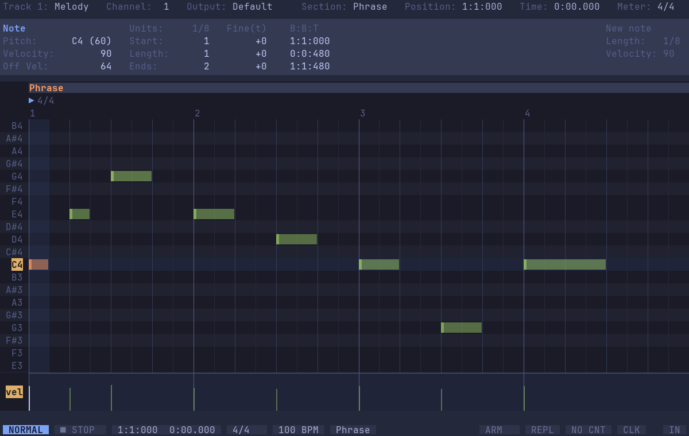

# Controllers, velocities and pedals {#sec-controllers}

Notes describe attacks and durations. Much of an instrument's phrasing lives
in the messages between them: modulation, expression, pitch bend, aftertouch
and pedals. The controller lane makes those messages visible against the
notes they affect.

There is one displayed lane at a time in this edition. It can show note
velocity, a controller, pitch bend or channel aftertouch. The lane choice
belongs to each track and is saved in the song.

## Choosing a lane and choosing its focus

`, c c` opens the lane chooser. The list includes Velocity, recently chosen
lanes, controllers present on the track and useful common choices. A name
or number narrows the list. `:lane cc74`, `:lane bend`, `:lane pressure`
and `:lane velocity` choose directly. `[c` and `]c` move between controllers
the track already contains.

Choosing what the lane displays and moving the cursor into it are separate
actions. `gl`, remembered as “go to lane”, puts the focus there. Escape returns
to the notes. The lit lane name and tinted background make the current focus
visible, because the same directions have different purposes in the notes
and in a value display.

## Velocity belongs to a note

The velocity lane draws one bar for each note. Notes starting together fan
out so their individual values remain accessible. Velocity is not an
independent event that can be moved away from its note: changing it changes
the note's attack value.

{#fig-velocity-lane fig-alt="The example melody above its velocity bars; vel is lit to show lane focus and the current note's bar is brighter than the others."}

In this lane, Tab and Shift-Tab visit the next and previous notes; Right
and Left (or `l` and `h`) provide the same forward and backward movement.
A chord's simultaneous notes are visited from low to
high pitch. Ctrl-A and Ctrl-X step velocity up and down; a number followed
by Enter sets an exact value. Enter alone asks for a value or change, such
as `100`, `+10` or `80%`.

A `v` selection follows notes between its anchor and cursor. A Ctrl-V box
restricts both note positions and velocities: it can isolate the unusually
loud notes in a passage without taking its softer accompaniment. Inside a
box, Down and Up (or `j` and `k`) change the velocity edge by one, and
Shift-Down and Shift-Up (or `J` and `K`) by ten.
`o` swaps its active corner.

When an edit moves the selected velocities outside their original band,
the selection keeps those notes until deliberately redefined. This permits
several adjustments to the same musical group. A number and Enter assigns
the same velocity to the selected notes, while steps preserve their differences.

Deletion and time movement are deliberately unavailable in the velocity
lane. They belong to the notes themselves. Returning to the piano roll
makes that broader intention explicit.

## Continuous controller values are held between events

A controller event changes a value at an instant. The receiver holds that
value until another message changes it. The lane therefore joins events
with a faint held-value line; it is not implying that the stored messages
form a continuous smooth curve.

The cursor may sit between events. The inspector then shows the held value,
which can be musically important even when there is no event at the cursor.
Pitch bend is drawn above and below its centre; ordinary controllers and
channel pressure use their own value ranges.

| Value | Range |
| --- | --- |
| Note velocity | 1 to 127 |
| Controller or channel pressure | 0 to 127 |
| Pitch bend | -8192 to +8191, with 0 at centre |

The instrument decides how a controller or bend value affects sound. A bend
value is not itself a number of semitones; the receiver's bend range matters.

| In a controller lane | Meaning |
| --- | --- |
| Tab / Shift-Tab | Visit stored events |
| Left / Right, or `h` / `l` | Move by grid steps, including empty time |
| Shift-Left / Shift-Right, or `H` / `L` | Nudge the cursor between grid lines |
| Ctrl-A / Ctrl-X | Step the current or selected values |
| Number then Enter | Set a value, or add an event at an empty position |
| Enter | Ask for an exact value or relative change |
| `o` | Add an event using the preceding value |
| `x`, or `d` with a target | Delete events |
| Alt-Left / Alt-Right, or `Alt-h` / `Alt-l` | Move events by grid steps |
| Alt-Shift-Left / Alt-Shift-Right, or `Alt-H` / `Alt-L` | Move events by a nudge |

Notice the difference from velocity: here Left and Right (or `h` and `l`)
move through **time**,
while Tab visits the events that exist. This allows a new controller value
to be placed between old ones. In the velocity lane all useful values
already belong to notes, so left and right visit those notes instead.

A controller value of zero is valid. `0` followed by Enter sets it, rather
than treating that sequence as a movement to the start. Pitch bend also
accepts negative values; the prompt identifies the value being edited.

`v` takes a time range of events and Ctrl-V a time-and-value box. The same
selection idea applies, but the vertical dimension now means value rather
than pitch. Moving or deleting data must preserve the order and validity
of the messages; an invalid batch is refused.

## Pedals can be understood as regions

For switch-like controllers 64 to 69, the lane can show **regions** where
the control is down. Sustain, sostenuto and soft pedal are familiar examples.
A region begins at a press and ends at a release, much as a note begins and
ends. This view makes the musical duration of a gesture easier to read than
a pair of value changes.

`, c v` switches between regions and the underlying values. The values
remain important for imported half-pedal performances, where intermediate
values carry meaning. The region view is an editing interpretation, not a
reason to discard those original values.

In the region view, Tab visits presses, ordinary left and right move through
time, and `o` adds a press at the cursor. `=` and `-` move the release later
or earlier by the grid, while `+` and `_` use a nudge. Alt-left and Alt-right
move the region, and `x`, `d` and `y` act on whole regions. A new region or
lengthening cannot run into a later press; a selected batch is checked as a
whole. Ctrl-V boxes are not offered in this region view.

## Sustain changes the sounding end of a note

The end of a stored note and the end of its sound can differ. Sustain holds
a released note until the pedal lifts. The piano roll can draw a thin
**sustain tail** to that lift, while leaving the note's stored length intact.
`, T s` toggles the tails. `, T S` toggles a tint over times when sustain is
down, making a broad pedalling gesture visible behind the notes.

This distinction is valuable when editing articulation: shortening a note
may make no audible difference while the pedal remains down. The tails show
why without rewriting the note to imitate sustain.

## Pedalling tools express musical intentions

The pedalling group is available under `, c P` and `, x P`. Its tools act
on a target like other transforms:

- **Re-pedal** writes sustain changes around chord changes, replacing the
  target's existing sustain. It suits constructing pedalling from the notes.
- **Re-time** brings played pedalling towards nearby chord changes, retaining
  more of the performer's chosen pattern.
- **Each bar or beat** supplies a regular pedalling pattern.
- **Clean** removes repeated or flickering changes.
- **Clear** removes the chosen pedal data; **offset** moves its timing.
- **Bake** turns sustain's effect into longer notes, useful for a destination
  that should receive note lengths rather than pedal messages.

The lift before a change and the new press after it are measured in
milliseconds. `pedallift` and `pedaldown` provide defaults, initially 10 ms
and 60 ms. They describe a real-time separation around the harmonic change,
not another subdivision of the editing grid.

These tools are alternatives with different musical assumptions. Re-pedalling
from scratch and correcting an expressive pedal performance are not the
same decision. The reference lists their parameters in
@sec-transform-reference; comparing an undo with the edited result remains
part of judging the phrasing.

## Other MIDI event types

The event list provides access to messages outside the displayed lane.
`, e` or `:event-insert` adds a non-note event at the cursor. Examples include
`:event-insert cc 7 100`, `:event-insert program 5`, `:event-insert bend -200`
and `:event-insert pressure 60`. Note entry has its own commands because a
note also needs a duration.

The insertion command also accepts polyphonic aftertouch, SysEx and text
kinds. Polyphonic aftertouch is pressure for a particular pitch, distinct
from the channel pressure shown in the lane. SysEx data is device-specific;
its byte sequence belongs to the receiving instrument's specification.
Text events can retain lyrics, cues or other information alongside the music.
