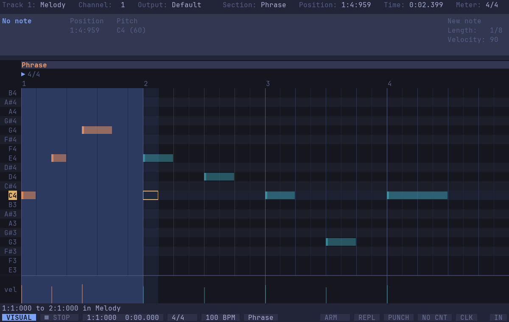

# The editing language {#sec-editing-language}

Modal combines a small set of actions with descriptions of the music they
should affect. You can select music and then act on it, or describe the
action and its target directly. Both approaches use the same rules.

Selection makes the target visible before an edit. Once that relationship
is clear, a sequence such as `>ib` expresses the same intention directly:
transpose the notes in this bar. The shorter form follows from the idea;
it need not be learned as an unrelated shortcut.

## Modes tell you what typing will do

When you are moving around the song, Modal is in **Normal mode**. Letters
are commands here; typing a track name does not enter that name into the
song. A command opens a field or prompt when it needs text. This separation
lets single letters express musical actions without needing a modifier
key for every command.

An **operator** is one of those actions, such as deleting or transposing.
It needs a target: the music it should affect. **Operator-pending** is the
state in which the action has been chosen but its target has not.

| State | What Modal expects | How to leave it |
| --- | --- | --- |
| Normal | Movement or an action | Start another operation |
| Visual | A selection, then an action on it | Escape ends the selection |
| Operator-pending | A target for the action already chosen | Escape cancels it |
| Command line or a question | Text or one of the offered answers | Enter accepts; Escape cancels |

Some editors use a question in the message row; others edit a field in
place. Follow the prompt's instructions. A yes-or-no question takes `y`,
`n` or Escape. Backspace on an empty input line does not dismiss it.

Note entry currently uses commands such as `o` in the piano roll. A separate
Insert mode for step entry is planned, but is not available in this edition.

## The musical example

The examples use Melody's first bar in First phrase. It contains C4 on
beat 1, E4 on beat 2 and G4 on beat 3. Bass also has music in that bar.
Unless stated otherwise, each example starts with the original music and
the cursor on Melody. The results are described here so that you can
reason about them without reproducing a sequence of steps.

## Select, look, then act

Visual mode allows selection before action. `vib` combines `v`, entering
Visual mode, with `ib`, **in bar**: the contents of the current bar. The
notes starting in Melody's first bar are highlighted, making the target
visible before anything changes.

{#fig-selection fig-alt="The piano roll in Visual mode after vib, with the first bar's three melody notes highlighted."}

With this selection, `>` moves the selected notes up one semitone: C4 becomes C♯4,
E4 becomes F4 and G4 becomes G♯4. Bass stays as it was. The selection stays
available for another action. Escape ends the selection; `u` then undoes
the transposition. This gives two separate decisions: what music belongs
to the edit, and what change to make to it.

This is a complete editing pattern: **choose the music, inspect the
selection, apply an action**. It is useful even after you learn the
shorter forms.

## An operator is an action waiting for its target

Without a selection, `>` leaves Modal waiting for a target. This is
**operator-pending**: you have chosen transposition, and must say which
notes to transpose. The message row explains what is waiting, and a pause
reveals the hint menu's possible targets. They are grouped as **objects**,
whole musical things, and **motions**, which can describe a range from the
cursor. Both are explained below.

{#fig-operator-hints fig-alt="Modal waiting after the greater-than transpose operator, with separate lists of objects and motions and descriptions of their targets."}

Completing the action with `ib` produces `>ib`, transposing this bar's
notes just as `vib` followed by `>` did. Enter is unnecessary: the complete
sequence already supplies the action and its target. `u` restores the
original notes.

An **operator** says what to do. An **object** says which whole musical
thing to use. You can read `>ib` aloud as “transpose up, in bar”.

| Operator | Action | Example |
| --- | --- | --- |
| `>` / `<` | Transpose up / down a semitone | `>ib` transposes this bar |
| `d` | Delete | `dib` clears this bar's contents |
| `y` | Copy into a register, called *yank* | `yib` copies this bar |
| `q` | Quantise note starts to the grid | `qib` quantises this bar |
| `^` | Set or change note velocity | `^ib` asks how to change this bar |
| `t` / `T` | Shift later / earlier by a grid step | `tib` shifts this bar |

Transposition, velocity and quantise affect notes. Other operations can
include controllers as well, depending on their target and view. We will
return to those details in the full edition.

## Objects describe whole things

An object names a musical thing at the cursor, rather than a distance to
travel. It can include music before the cursor as well as after it. Its
letters are mnemonic: `b` for bar, `c` for chord, `s` for section and `t`
for track. The `i` prefix can be read as **in**: work on the contents.

| Object | Meaning on the current track |
| --- | --- |
| `in` | The note or event under the cursor |
| `ic` | Its chord, in the piano roll or event list |
| `ib` | Events starting in this bar |
| `is` | Events in this section on this track |
| `it` | This track's events |

Thus `ic` is “in chord”, `is` “in section” and `it` “in track”. The same
target descriptions can be used with different actions. Knowing `ib` and
the delete operator `d` is enough to understand `dib`, even on first seeing
it. Here `i` begins an object after an operator, or while selecting; it
does not enter a mode on its own.

The companion prefix `a` means **around**: the thing itself rather than
just its contents. For a bar, `ib` is “in bar” and `ab` “around bar”. That
distinction matters when an action can remove time, as we will see below.

Many operators doubled act on the current bar: `dd` means the same as
`dib`, and `>>` transposes this bar up a semitone. You can keep using the
explicit object spelling while learning.

## Motions describe a range from here

A **motion** normally moves the cursor. Some motions can also finish an
operator: then they describe a range from the cursor to the boundary named.

Suppose the cursor is on Melody's E4 at beat 2. In `d]b`, `d` deletes,
and `]b` names the next bar line. The action takes the range from beat 2
to that boundary: E4 and G4 disappear, while C4 before the cursor remains.
The `b` still means bar; `]` points to its next boundary, while `[` points
back to the previous one.

At the same E4, `dib` clears all three notes, because the object describes
the whole bar. A motion is useful for “from here onwards”; an object is
useful for “this whole thing”, regardless of where inside it the cursor sits.

| Target | Read it as | Difference |
| --- | --- | --- |
| `ib` | Contents of this bar | The whole bar, wherever you are inside it |
| `]b` | From here to the next bar line | Only the remainder of the bar |
| `is` | Contents of this section | The whole section on this track |
| `]s` | From here to the next section | Only the remainder of the section |

Not every navigation key is an operator target. Tab and the chord-jump
keys `(` and `)` move you, but do not describe ranges for an operator.
The hint menu shows the ranges available where you are.

## Counts: how much, or how many?

A number makes a command travel further or act on more music. `3l` moves
three steps. With an operator that has an amount, the number's position
matters:

| Keys | Meaning |
| --- | --- |
| `3>ib` | Transpose this bar up **three semitones** |
| `>3ib` | Transpose **three bars** up one semitone |
| `2tib` | Shift this bar later by **two grid steps** |
| `d3ib` | Delete the contents of **three bars** |
| `3dd` | Also delete the contents of **three bars** |

For Melody, `3>ib` changes the first bar's C4 to D♯4. In contrast, `>3ib`
changes that C4 to C♯4 and also transposes bars 2 and 3; bar 4 is unchanged.
The order distinguishes the amount of the change from the extent of the music.

For deletion and copying, a count before or after the operator counts the
target; counts in both places multiply. Start with one count at a time.

## Scope: where you are determines what is included

An object acts within the cursor's place. In a track view, `is` is this
track's events in the section. On the arrangement's section strip, `is`
is the section's events on **every track**.

For example, `vis` on Melody's arrangement row selects Melody's contents
in Phrase. The same `vis` on the section strip selects Phrase's contents
on both Melody and Bass. The strip represents the song's structure, so
it is the appropriate place for work spanning the section as a whole.
The track row represents one part, so an object there stays within that part.

The same principle explains why keys sometimes do different things in
different places. In the piano roll, Down (or `j`) moves down a semitone,
and capital `J` extends that to an octave. On the section strip, `J` instead
means join sections, while Down (or `j`) moves back to the tracks.
If unsure, pause for hints or open `, ?`
in the place where you intend to work.

## Contents and time are different targets

`dib` removes events and leaves the space they occupied. It does not
shorten the section. `dab` takes out a bar as time on the current track,
moving the rest of that section's material earlier. The section itself
keeps its length: silence gathers at its end, and later sections stay aligned.

Use `dab` from the arrangement or piano roll, not the event list. To remove
a bar on every track and shorten the song, use the separate `:bar-delete`
command (`, b d`). This distinction is useful enough to learn before attempting
large rearrangements.

| Intention | Command | Result |
| --- | --- | --- |
| Clear the bar on this track | `dib` | Later events stay in place |
| Close up a bar on this track | `dab` | Later material in this section moves earlier |
| Remove a song bar across all tracks | `:bar-delete` (`, b d`) | The song becomes shorter |

For Melody's first bar, `dib` leaves silence before the second bar's E4.
`dab` instead brings that E4 to the start of the first bar. The “in” and
“around” mnemonics remind you whether the target is the music contained
in a bar or the bar as a span of time.

## Choosing selections yourself

Objects are convenient, but a selection can also grow as the cursor moves.
The three selection keys describe shapes on the arrangement or piano roll,
where time runs horizontally:

- **`v`: a vertical selection.** Think of a vertical band across time: it
  includes every track in the arrangement, or every pitch on the piano roll's
  current track. Moving in time widens or narrows the band.
- **`V`: a horizontal selection.** Think of whole horizontal rows extending
  across the song: selected tracks in the arrangement, or selected pitch rows
  in the piano roll. Moving vertically adds or removes rows.
- **`Ctrl-V`: a box.** Both dimensions have boundaries, allowing a passage
  on just some tracks or pitches to be chosen.

The shape helps express the musical intention. A vertical band suits a
passage at all pitches; a horizontal row suits one pitch throughout a part;
a box suits a few notes within a limited pitch range.

| Key | In the piano roll | In the arrangement |
| --- | --- | --- |
| `v` | A vertical band: time at every pitch | A vertical band: time across every track |
| `Ctrl-V` | A box of pitches and time | A box of tracks and time |
| `V` | Horizontal pitch rows across the track | Horizontal rows of whole tracks' contents |

This is an important context difference: `v` on an arrangement track is
not restricted to that track. Use a box when you want to choose which
tracks are included. An object such as `ib` describes its own scope, as
we saw above with `vib`. In the event list, where events are rows rather
than a horizontal timeline, `v` selects event rows; the vertical-band image
belongs to the arrangement and piano roll.

Escape ends a selection. `gv` selects the last selection again. Once you
have selected music, an operator acts immediately; it does not wait for
another target. Pressing `o` in Visual mode swaps which end you are moving.

## Copy, put and repeat

Modal calls copying **yanking**, because `y` is its operator. The copied
music is held in a **register**. Deleted music also goes into a register.
This is Modal's internal storage for copied material, separate from your
operating system's clipboard, which `"+` reaches when you ask for it (see
@sec-efficient-work).

For example, `yib` on Melody's first bar copies its C4, E4 and G4. A `p`
at bar 2 **puts** that copy over the music already there. A copied bar goes
to the start of the destination bar, rather than the cursor's exact time
within it. The original music remains unless a collision makes the put
invalid. `u` undoes the put without undoing the earlier copying, which did
not change the song.

In these track views, `P` inserts the material and shifts later material
within the section. In Visual mode, `p` or `P` replaces the selection.
On the section strip, they put whole sections after or before the cursor's
section. Later chapters will work through each kind of put separately.

`.` repeats the last change, including its target and the answers to
questions it asked. `u` undoes a change, and Ctrl-R redoes it. Copying alone
does not change the song.

## The same action has several routes

You can select a bar with `vib` and press `>`, or type `>ib` directly.
For an explicit amount, select the bar and use `:transpose 3`. Without
a selection, that command takes the current bar. The palette can find
the named command if you cannot remember it. Its leader route, `, x t`,
asks for the amount; without an existing selection, it also needs a target.

These routes let you choose how much to remember. Start by selecting and
looking. Use the palette and hint menus whenever you need them. As a
sequence becomes familiar, combine an operator with a target directly.

You now know the pieces of Modal's editing language: **an action, a target,
an optional count, and the context where you are working**. The full
manual will build on them with arrangement, recording and performance
editing, using the same rules throughout.
