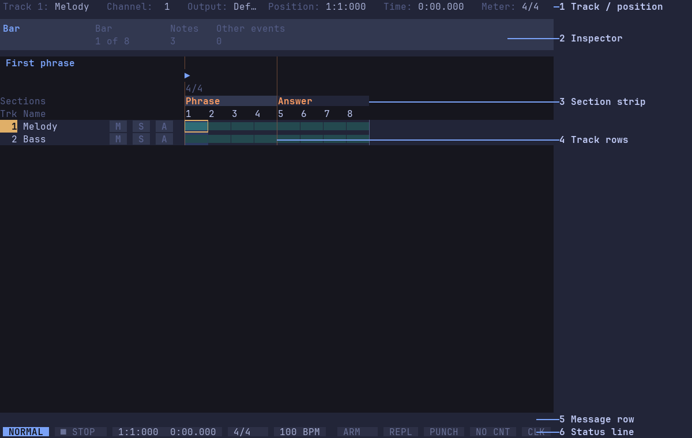
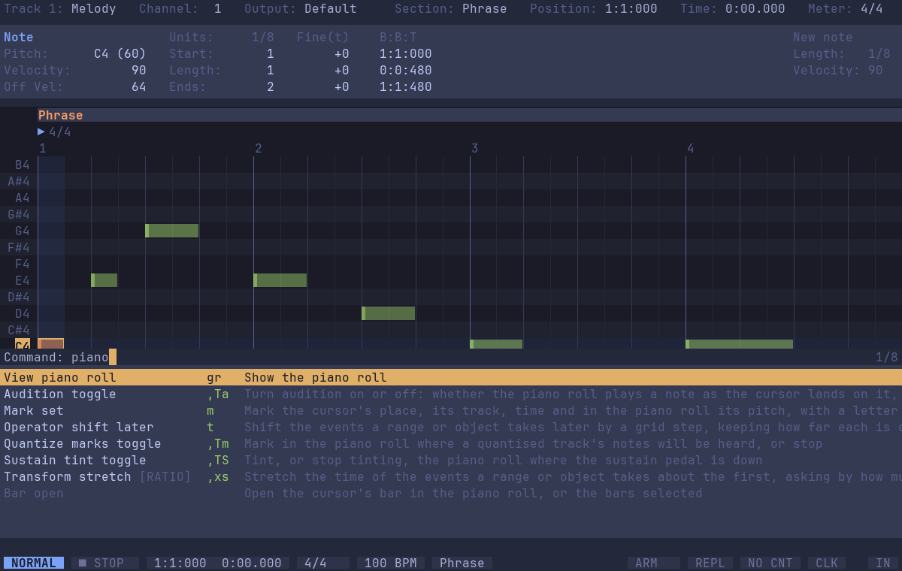

# Finding your way {#sec-first-session}

Modal puts musical structure and keyboard control at the centre of its
interface. The arrangement gives an overview of the song; other views reveal
the notes, events and settings at the same musical location. Understanding
that relationship makes the keyboard easier to learn: the keys become ways
to express an intention, rather than a list of shortcuts to memorise.

This chapter introduces the window, the ways to find commands and the MIDI
connections that carry the music to an instrument. The examples describe
what happens; you do not need Modal open to follow them.

## The parts of the window {#sec-window}

Modal opens in the **arrangement**, where time runs from left to right and
each track occupies a row. The illustrations use the example song First
phrase: Melody and Bass are its tracks, and Phrase and Answer are its two
four-bar sections.

The **cursor** is the highlighted working location: the place a movement
or edit refers to. In this arrangement it is on Melody's first bar.

{#fig-arrangement fig-alt="An annotated arrangement: 1 is the track and position bar at the top; 2 the inspector below it; 3 the section strip; 4 the track rows and their bars; 5 the message row near the bottom; and 6 the bottom status line."}

1. **Track and position bar:** the current track and musical location,
   including section, time and meter.
2. **Inspector:** details of what is under the cursor; here, the contents of a bar.
3. **Section strip:** the song's named sections, such as a verse or chorus.
4. **Track rows:** each track's bars, shaded by how busy they are.
5. **Message row:** feedback, questions, unfinished key sequences and the command line.
6. **Status line:** the editing mode, transport and whether playback or recording
   options are enabled.

The **inspector** changes with the thing being inspected. On an arrangement
bar it summarises the events there. On a note it shows pitch, velocity and
timing. In a settings view it explains the current field. It is a source of
context while you work, without requiring another window.

The **message row** is where Modal communicates with you. A question or a
request for a value appears there, as does the reason an edit was refused.
The **status line** remains underneath it, so the mode and transport stay
visible while a question is being answered. A mode describes how Modal is
interpreting the keys: for example, as commands, a selection or typed text.
@sec-editing-language explains those states in detail.

The same surrounding parts remain when the central view changes. In the
**piano roll**, notes occupy a grid of time and pitch. The inspector now
describes a note, and a controller lane sits underneath the notes.

{#fig-piano-roll fig-alt="An annotated piano roll: 1 and 2 mark the track bar and note inspector; 7 marks the time ruler; 8 the notes on the time-and-pitch grid; 9 the velocity lane; and 5 and 6 the message row and status line."}

7. **Time ruler:** sections, bar numbers and other signs locating the music in time.
8. **Notes:** their pitches vertically and their starts and lengths horizontally.
9. **Controller lane:** initially the notes' velocities; it can also show
   controllers, pitch bend and aftertouch.

These pictures are maps of the interface, not states you must reproduce.
The details change with the music and the window size; the parts have the
same purposes throughout the book.

## One song, several views

A **view** presents one aspect of the song. The arrangement answers “where
in the piece?”, the piano roll “which pitches and rhythms?”, and the event
list “what exactly is stored?”. A note edited in one is the same note in
the others. Switching views does not convert or export the music.

The views share a **cursor**: a musical working location consisting of a
track and time, with a pitch in the piano roll. Each view represents that
location differently, as a bar, a position on a grid, an event row or a
settings cell. This is why switching views is useful while editing: you
can move from an overview to detail at the place you are already considering.

Many view keys begin with `g`, which can be remembered as **go**. For
example, `ga` is “go to arrangement”, `ge` “go to event list”, and `gt`
“go to tracks”. The second letter often names the destination; `gr` uses
the **r** in piano roll. The mnemonic helps recall a binding without being
a rule from which every command can be guessed.

| Keys | View or focus | Useful for |
| --- | --- | --- |
| `ga` | Arrangement | Finding bars and working across tracks |
| `gr` | Piano roll | Writing and shaping notes on one track |
| `ge` | Event list | Inspecting individual MIDI events and fields |
| `gc` | Conductor's event list | Tempo and meter changes |
| `gt` | Tracks | Routing, channels and track settings |
| `gm` | Ports | This machine's MIDI connections |
| `gs` in the arrangement | Section strip | Working on the song's sections |
| Backspace | Previous view | Returning after inspecting another view |

Enter on an arrangement bar opens it in the piano roll. This is the
overview-to-detail route: choose a bar first, then look inside it.
The **conductor** is a special track for the song's tempo and meter,
separate from the tracks that play notes.

### Moving through music

Movement follows the shape of the view. In the arrangement, left and right
mean earlier and later bars, and up and down mean tracks. In the piano roll,
left and right mean time, while up and down mean pitch. In the event list,
the same directions mean fields and event rows.

The arrow keys express those directions directly. The letter keys `h`, `j`,
`k` and `l` offer the same arrangement with the hand resting on the letter
keys: `h` is left, `j` down, `k` up and `l` right. The unusual order comes
from Vim. There is no need to learn it before using the arrows; its benefit
is avoiding repeated trips between the letter keys and the arrow cluster.

In the piano roll, an ordinary time step follows the **editing grid**, such
as an eighth note. Tab and Shift-Tab instead visit the next and previous
notes, even at other pitches or off the grid. These serve different
purposes: grid movement reaches a musical position, while note navigation
reaches existing material. Moving the cursor alone does not move a note.

`gg` goes to the start of the song, and `G` to the end. A number with `G`
chooses a bar: `2G` goes to bar 2. Numbers used this way are called
**counts**; they will also help describe edits in @sec-editing-language.

## Discovering commands {#sec-discovery}

A **command** is a named action; a **key binding** is a shortcut that invokes
it. For example, `ga` invokes `view-arrangement`, which can also be run as
`:view-arrangement`. A leader sequence invokes a named command in the same
way. These are different routes to an action, not different kinds of action.

Some commands have no default binding because they are needed less often.
The `:` line and palette still make them available. A personal binding can
give one of them a convenient key or leader sequence, and existing bindings
can be changed too; @sec-customisation explains how. The command's context
still applies whichever route invokes it.

Modal gives you three ways to find an action: follow the keys towards it,
look up its name, or type a named command. They complement each other.
The key menus are useful when you know roughly where an action belongs;
the palette is useful when you know what you want to achieve but not its keys.

### The leader and hint menus

The **leader** starts groups of related commands. By default it is comma,
`,`; the next letter chooses a group, and a further key chooses an action.
For example, `, v` leads to Views and `, v r` opens the piano roll. That
is another binding for the same action as `gr`.

A short pause after the leader shows a **hint menu** listing what can
follow. The menu also appears after other prefixes such as `g`, `z` and
`]`. It lets you recognise and choose an action before you have memorised
the whole sequence. Escape cancels an unfinished sequence. Ordinary key
sequences run as soon as they are complete; they do not need Enter.

The list of **keys here**, `, ?`, shows every binding available in the
current context. It changes with the view and focus, so it answers “what
can I do here?” more directly than a single application-wide shortcut list.
Escape closes the list.

### The command palette

The **command palette**, opened with Ctrl-P, searches command names and
descriptions. A query such as `piano` finds the piano-roll view and also
shows its bindings. This makes it both a way to work and a way to learn
the keys of actions you use often.

{#fig-palette fig-alt="Modal's command palette with piano typed and the piano-roll command shown with its key bindings."}

Up and Down choose a match, and Enter runs it. Tab puts the chosen command
on the command line, where its arguments can be inspected or extended;
Escape closes the palette.

```{=typst}
#block(breakable: false)[
```

Start a palette query with one of these prefixes to search for a destination
or setting.

| Prefix | Looks for | Example |
| --- | --- | --- |
| `@` | Sections | `@Answer` finds the Answer section |
| `#` | Tracks | `#Bass` finds the Bass track |
| `'` | Labels and marks | `'Answer starts` finds a label at that position |
| `?` | Settings | `?audition` finds the audition setting and shows its value |
| `~` | Named drum pitches on the current piano-roll track | `~snare` lists the mapped snare articulations |

```{=typst}
]
```

The drum pitch list shows how many notes use each pitch on this track.
Choosing a pitch moves the cursor to its row at the current time.

## The command line and settings

The **command line** is Modal's own place for named commands. `:` opens it
on the message row. It serves a similar purpose to a menu action with
arguments: the name says what to do, and the words after it supply details.
It is separate from the operating system's terminal.

For example, `:grid 1/8` sets the current track's editing grid to eighth
notes. The command expresses an exact value without cycling through other
grid sizes. As in all the book's colon examples, `:` opens the line, the
rest is typed into it, and Enter runs the command.

The `set` command changes application **settings**, sometimes called
variables. `:set fontsize=14` changes the text size immediately;
`:set fontsize?` reports its current value. `:set theme=light` and
`:set theme=dark` choose the built-in themes. A setting belongs to the
application; a song or track property may have its own field or command,
as the track's grid does.

Tab completes command names and arguments. Up and Down recall commands
from the current session, and Escape abandons the line being typed. These
facilities make the command line useful even when the spelling is unfamiliar.

Live application settings are not automatically saved as startup preferences.
The `modalrc` configuration file holds commands to run at startup; the full
manual will explain how to keep chosen settings there. MIDI port preferences
are saved separately for this machine, as described below.

## Opening songs

Modal can start with a new song, open a native `.modal` song, or import a
Standard MIDI File. `:e` opens the file chooser; `:e FILE` names a file
directly. `modal --demo` starts with a larger built-in demonstration song.

A song can also be given when launching the application from a terminal.
These examples show the native path notation on each system, from the
directory containing the executable:

**Linux terminal**

```text
./modal "/home/you/Music/first-phrase.modal"
```

**Windows PowerShell**

```text
.\modal.exe "C:\Users\you\Music\first-phrase.modal"
```

The directories are examples, not required locations. Quotes keep a path
containing spaces together as one argument. Inside Modal, the file chooser
avoids the need to type a path at all.

## MIDI ports: where the music goes {#sec-midi-ports}

Modal stores, edits and sends MIDI; it does not turn MIDI into sound. A
synthesiser, sampler or other instrument receives the messages and produces
audio. The connection between them is a **MIDI port**: a named endpoint
through which a program or device sends or receives MIDI messages.

The direction is relative to the program using it. A Modal **output** carries
messages away from Modal; the receiving instrument takes them through an
**input**. The connection may cross a physical cable, stay entirely inside
the computer, or combine USB and a hardware MIDI interface. A MIDI port is
not an audio output, and selecting one does not choose speakers or headphones.

Each track has an **output port** and a **MIDI channel**. The port chooses
the destination; the channel, from 1 to 16, distinguishes parts sharing that
destination. Two tracks can therefore play different parts through one port,
provided the receiving instrument is configured for their channels.

### Hardware instruments

For an external synthesiser, Modal sends to the operating system's MIDI
output for the device or interface. With a USB synthesiser, the USB connection
may carry MIDI directly. With a conventional MIDI cable, the interface's
MIDI OUT connects to the instrument's MIDI IN.

The instrument's sound still needs an audio path to headphones, speakers or
an audio interface. The MIDI connection carries the performance instructions,
not the resulting audio.

### Software instruments on Linux

There are two common arrangements. A software synthesiser or host can expose
a MIDI input of its own, which Modal can choose as an output destination.
Alternatively, Modal can create a named **virtual port** for other software
to receive from. A virtual port is a software MIDI connection; it needs no
physical interface or MIDI cable.

By default, Modal provides one port of its own, named `Modal`. It is an
output from Modal's point of view. To the receiving program it appears as a
MIDI source that can be connected or selected for input, just as it would
receive from a MIDI keyboard. The receiver must subscribe to that source,
either in its own MIDI setup or through an ALSA-compatible connection manager.
Creating the port does not connect a synthesiser automatically.

The `ownports` setting controls how many ports Modal creates, and
`ownportname` their name. A song's tracks can address those ports as they
would a hardware destination. The software instrument or host handles its
own audio output.

### Software instruments on Windows

Modal's current Windows MIDI backend cannot create ports of its own. To
connect it to a software instrument, a **virtual MIDI cable**, or loopback
port, provides the bridge. Modal sends to the cable's output endpoint and
the instrument receives from the corresponding input endpoint.

Here, *loopback* means routing MIDI between programs within the computer.
It does not mean feeding a track back into itself. The cable must already
exist and be available to both programs. Once it is, Modal treats its output
endpoint like any other MIDI destination; the instrument or host selects
the receiving endpoint in its MIDI setup.

| Destination | MIDI path |
| --- | --- |
| External instrument, either system | Modal → device/interface output → instrument MIDI input |
| Linux software instrument with its own port | Modal → instrument's exposed MIDI input |
| Linux using Modal's own port | Modal's virtual source → receiver subscribed to it |
| Windows software instrument | Modal → virtual cable → instrument MIDI input |

### Enabling and assigning ports

The **Ports view** (`gm`) manages the machine's available MIDI inputs and
outputs. New ports start **disabled**, so discovering a device does not
immediately send to it or listen to it. Enabling a port makes it available
for use. An optional alias makes a long device name easier to recognise.

A **default output** gives tracks a destination without putting a particular
device name into every track. A track whose Output is `Default` follows
that machine's default; an explicit output name chooses that destination
instead. This distinction makes a song easier to use on another computer
with a different setup. Port preferences are remembered on the machine,
while the track's routing choice is saved in the song.

The Ports view is a table: Down and Up (or `j` and `k`) move through rows,
Left and Right (or `h` and `l`) through columns, and Enter edits or toggles
the current cell. The Enabled and Default
columns control availability and the default choice. The **Tracks view**
(`gt`) holds each track's Output and Channel fields. A warning in the
inspector explains when a chosen port is missing, disabled or unavailable.

First phrase uses the default output, with Melody on channel 1 and Bass on
channel 2. A receiver listening only on channel 1 will therefore play Melody
alone. This is a routing choice, independent of whether both tracks contain
notes.

## Playing and saving

The cursor's working position is separate from two playback positions. The
**playhead** shows where playback has reached; the **play-from marker**
remembers where it will start. Keeping editing and playback positions
separate lets you inspect one passage while repeatedly hearing another.

Space starts playback from the marker, or stops it if it is already playing.
`m` then Space puts the marker at the cursor without starting playback;
Ctrl-Space puts it there and starts immediately. `Ctrl-.` is **panic**,
which releases sounding notes and pedals if something is left held.

If playback is silent, the useful questions are: is the track routed to an
enabled output, is the receiver connected to that output, does it receive
the track's channel, and is its audio output audible? The MIDI and audio
parts of that path are separate.

`:w` saves the native `.modal` song; `:w FILE` saves to a chosen path.
The native file keeps Modal's song structure and settings. `:export`
writes a Standard MIDI File for other programs. Relative song paths begin
in the current song's folder.

`:q` quits, refusing if there are unsaved changes. `:q!` explicitly discards
them. During recording, file operations require the take to be stopped and
finished first. These safeguards let the file commands remain brief while
making the decision to lose work explicit.
