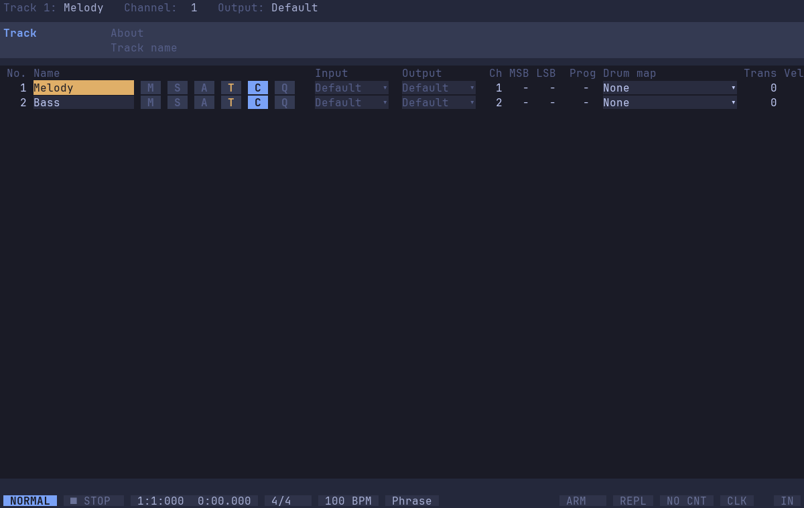
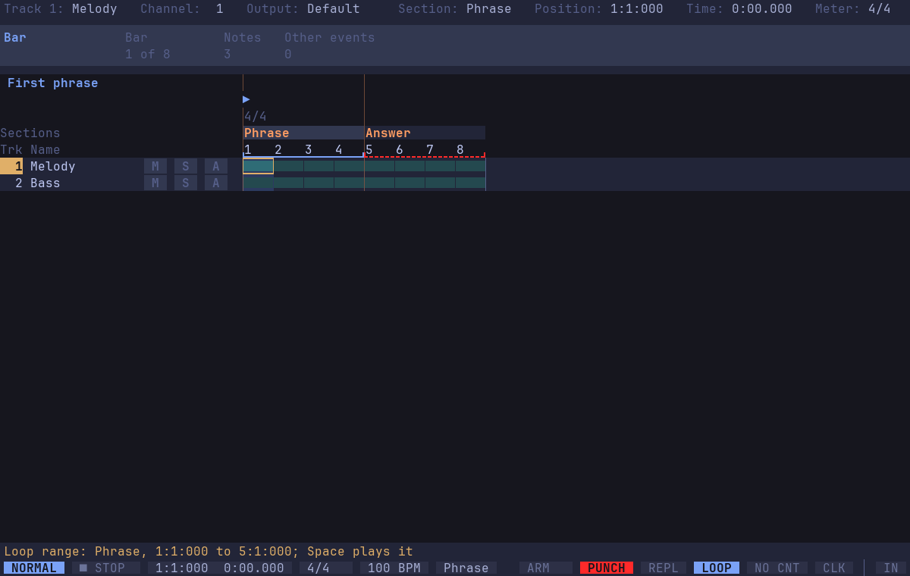
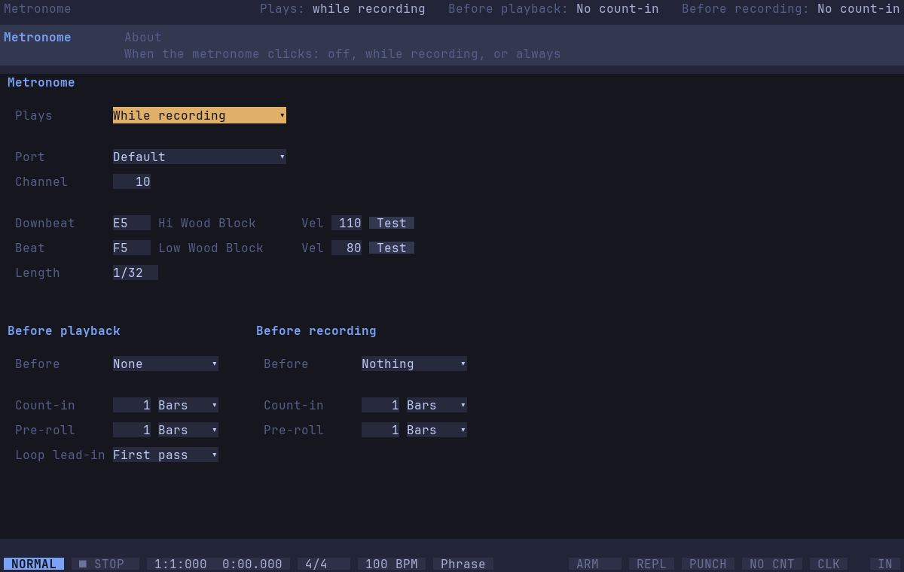
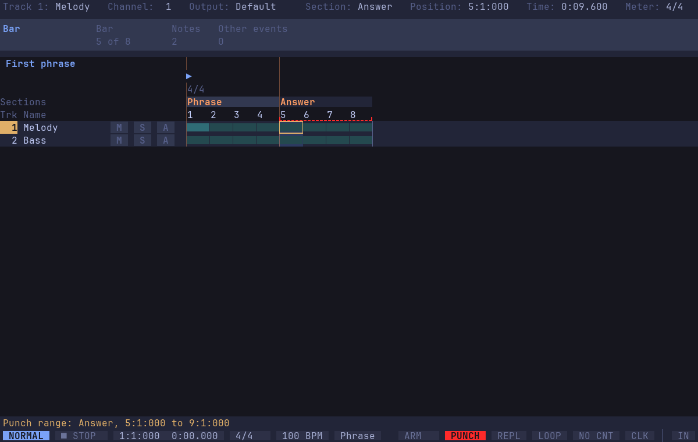

# Tracks, playback and recording {#sec-recording}

A track holds a part's musical identity: its events, routing, editing defaults
and playback settings. Recording adds an incoming performance to that part.
The important distinction is between the instrument being heard, the track
being recorded, and the stored events that will be saved afterwards.

The port directions and operating-system connections introduced in
@sec-midi-ports are the foundation. This chapter describes how a song uses
those connections.

## Organising tracks

The **Tracks view** (`gt`) puts one track on each row, with settings in
columns. It suits comparison: two parts' channels, inputs or transpose
settings can be seen together. In the arrangement, the same parts appear
as bars through time.

{#fig-tracks fig-alt="The two tracks Melody and Bass in the Tracks table, with mute, solo, arm, Thru, chase and quantise buttons, input and output choices, channel and instrument settings."}

`, t a` adds a track after the current one, `, t i` before it, and `, t r`
renames it. A single addition asks for its name. `, t d` deletes the current
track or selected track rows, keeping the whole-track material in a register.
These actions are undoable. The conductor is separate and stays first.

In Tracks, `V` selects complete rows, including settings. `Vy` copies a track;
normal `p` and `P` insert copies after or before the current row, and Visual
put replaces selected rows. From any other view with a current track, the
Tracks group does the same: `, t y` yanks the whole track (or the tracks
selected with `V` or Ctrl-V), `, t p` and `, t P` (or plain `p` and `P`, while the
register holds whole tracks) put the yanked tracks as new ones after or before
the current track, and `, t D` duplicates the current
track just after it, leaving the register as it was. By contrast, `yit` in a
musical view takes a track's event contents. Copying a whole instrument part
and copying its music for another instrument are different operations.

`, t o` enters track-reordering mode. The rows can move up or down before
Enter accepts their order as one change, or Escape restores it. While this
mode is active other commands, including transport, are ignored. Alt-Up
and Alt-Down move tracks immediately instead.

## Editing settings in a table

Enter or `e` edits the selected cell. A fully highlighted value is replaced
by typing; a cursor movement retains it for editing. Enter accepts,
Escape cancels, and Tab commits and moves to the next editable column.
Up and Down step numeric values. A field marked with a down arrow has a
fixed-choice list; typing can help find the choice. Each cell edited this
way is its own undo step. Quantise opens several settings together in the
inspector, as described in @sec-inspector-editing. Drum map opens the map
chooser and comparison panel described below.

Whole-row selections support batch changes. Assigning a value sets it on
all selected tracks; stepping changes each relative to its own value. A
batch that would make any row invalid is refused as a whole. Names remain
individual, since giving every part the same name would obscure its identity.
Drum maps are also chosen on one track at a time.

Output chooses a destination, Input chooses what the track listens to, and
Channel is the MIDI channel the part uses. `Default` follows the machine's
chosen port; `All` on Input receives from all enabled inputs. An unavailable
saved choice remains visible with a warning, rather than silently falling
back to another device.

## Naming a drum part {#sec-drum-maps}

On a drum instrument, a note number identifies a sound: a kick, a snare or
one of several hi-hat articulations. A **drum map** gives those numbers useful
names. The stored notes continue playing their existing pitches; the map
makes the part easier to read and inspect.

Choose the **Drum map** field in Tracks and press Enter, or use `, t k`
(**k** for kit) from a view with a current track. `:drum-map` opens the same
chooser. Up and Down choose, typing narrows the list, Enter accepts and
Escape leaves things as they were. Choose **None**, **General MIDI**, or a
reusable map file. Maps are chosen on one track at a time, independently of
its MIDI channel. Putting a track on channel 10 does not choose a map.

The piano roll makes room for the drum names in its keyboard column. Rows
without names keep their pitch labels. Long names are shortened in the
column; the inspector shows the drum name alongside the ordinary pitch and
MIDI number. The same note-editing keys still apply, and the Pitch field
remains editable as a pitch or number. Choosing another map is one undo step.

{#fig-drum-map fig-alt="A piano roll whose pitch rows are labelled Kick, Snare, Closed hi-hat and Open hi-hat, with the kick's pitch and full drum name in the inspector."}

### A song owns its copy

The song stores the complete map with the track, so its names travel with it.
Reusable `.drum-map` files live in `drum-maps/` beside `modalrc`. Loading one
copies it into the track; changing that file later does not silently change
the song. Copying a whole track includes its map.

`:drum-map-load FILE` loads a copy, and `:drum-map-save FILE` writes the
track's map for reuse. Without a filename, either command opens Modal's
file picker (@sec-file-picker). Relative paths start in the `drum-maps/` directory, and a filename
without an extension gains `.drum-map`. Tab completes filenames; quote one
containing spaces, as in `:drum-map-load "Studio kit.drum-map"`.

Custom maps are edited as text at this stage. A small map can look like this:

```text
modal-drum-map 1
name "Studio kit"
36 "Kick"
38 "Snare"
42 "Closed hi-hat"
46 "Open hi-hat"
always-show 46
```

The numbers are MIDI note numbers, from 0 to 127. Name each number at most
once; leave unnamed numbers out. Several numbers may have the same name,
for example when an instrument offers two ways to trigger one articulation.
The `name` line is the map's identity; its filename can be different.
An instrument chart's octave labels may differ from Modal's, so establish
the MIDI numbers before copying its names.

An optional `always-show` line keeps that MIDI pitch visible in every fold.
Set or clear the mark from the piano roll with `zP`. `:w` saves the edit in
the song's own map. To update a reusable map on disk, use `:drum-map-save`,
select the existing file and confirm **Replace the saved copy**. Choose a
new filename to keep both files. The comparison shows changes to these marks.

### Reviewing different copies

Opening a song compares its maps with reusable files of the same internal
name. A brief notice flags differences; the Drum map chooser marks the
song's copy too. General MIDI can also be compared with the built-in map.
The song continues using its embedded copy until you choose otherwise.

Open `, t k` and press Enter on the song's current map to review it. If
several saved files have that name, choose the file to compare first. The
review shows changed names under **Song** and **Saved**, including entries
added or removed. PageUp and PageDown scroll long comparisons; Up and Down
choose an action and Enter takes it. Escape keeps both copies as they are.

{#fig-drum-map-review fig-alt="A comparison of Studio kit showing Kick and Snare in the Song column, Acoustic kick and Snare centre in Saved, and the keep, use, replace and save-as actions below."}

| Action | Result |
| --- | --- |
| Keep the song's copy | Leave both copies as they are |
| Use the saved copy | Replace this track's map, as one undo step |
| Replace the saved copy | Write the song's map over the reviewed file |
| Save as another map | Ask for a new map name and filename, then rename this track's copy after saving |

Choose a new filename when saving as another map to keep both files. Escape
at the name question or in the file picker leaves the song's name
unchanged. Undo can restore the track's former map or name; it does not
remove or restore reusable files. Other tracks and songs retain their own
copies.

Selecting a differing file in the drum-map save picker opens a comparison.
Choose **Replace the saved copy** to write the file or **Cancel save** to
leave it as it was. A save with a typed filename needs `:drum-map-save! FILE`
to reach the same confirmation. A same-name load also opens review when the
copies differ. If a saved file changes while a review is open, Modal shows
the current comparison before a replacement can proceed.

## Mute, Solo, Arm and Thru

The coloured letter buttons are related but answer different questions.

| Button | Question | Consequence |
| --- | --- | --- |
| Mute (`M`) | Should the stored part be silent? | Suppresses ordinary playback when no solo overrides it |
| Solo (`S`) | Which parts should be heard alone? | If any track is soloed, only soloed tracks play |
| Arm (`A`, `R` while recording) | Should this track receive the take? | Makes it a recording destination |
| Thru (`T`) | Should live input be heard through this track? | Sends matching input to its output while armed |
| Chase (`C`) | Should notes held at the playback start be started? | Recreates their remaining sound when enabled |
| Quantise (`Q`) | Should timing be adjusted during playback? | Applies the track's playback quantise settings |

Mute and Solo concern stored playback; Thru is how a live performance is
heard. An armed, muted track can therefore still pass live input. If any
track is soloed, a soloed track plays even when its Mute button is also on.

`M`, `S` and `A` work from musical views with a current track as well as
from Tracks. Arming is independent for each track, so several may be armed
at once. Modal names already-armed parts when another is armed to help make
that choice visible. `, r A` disarms every armed track at once, wherever the
cursor is, without going to each track.

`, r t` changes the current track's Thru. `, T t` is the machine-wide Thru
switch: both the machine switch and the track's own choice must permit it.
An unarmed track does not receive Thru merely because its T is enabled.

## Hearing and diagnosing input

The status line's **IN** light flashes as MIDI arrives. To see what arrived,
open the Ports view (`gm`): its **Last in** column shows the last channel
message from each input other than a note-off, such as `10 CC64 127` for the
sustain pedal on channel 10, so you can check every keyboard and controller
at once. This establishes that input reached Modal; it does not establish
that a track is armed, correctly routed or audible at its instrument.

Live input is sent to every matching armed track with Thru enabled. Incoming
channels are mapped to each destination track's channel, and playback
transpose and velocity offset also affect the monitored notes. Time offsets
are not applied to live Thru, since deliberately delaying the player's
monitoring would make playing harder.

The engine remembers the destinations of held notes and pedals. Their
releases still go to the original destinations if a setting changes while
they are held. Space stops playback without cutting off live held notes
whose releases are still expected; panic, Ctrl-., ends them too.

## Playback positions and rewind

The play-from marker gives Space a stable starting point independent of
the editing cursor. `m` then Space sets that marker, and Ctrl-Space sets it
and plays immediately. Space toggles playback and stop; Shift-Space stops
and returns to where the cursor was.

With **rewind** on, the marker stays where it was when playback stops.
This suits repeatedly checking the same passage. With rewind off, the marker
moves to the stopped position, which suits continuing through a piece.
`, T Space` changes the setting. The status line shows the marker while
stopped and the playhead while playing; the top bar still describes the cursor.

Chasing makes a mid-song start meaningful. Modal restores preceding program
and controller state, then, when note chasing is on, starts notes already
held for their remaining lengths. Note chase is useful for sustained parts;
it may be undesirable for drums whose attack should only occur at the
original note start. The C setting controls notes, not all state restoration.

## Repeating a passage {#sec-loop-playback}

A loop plays a span of time repeatedly so you can listen to a phrase or a
transition in context, or practise a part against it. As with a punch range
(@sec-punch-recording), you choose the span first and play it afterwards:
arming a loop plays nothing, and Space then plays it as often as you like.
Looping has a group of its own, `, L`:

- `, L L` arms the cursor's section. In Visual mode it arms the selection's
  span of time instead, for a few bars; selecting a run of sections on the
  section strip arms all of them.
- `, L l` (**l** for labels) chooses two song labels as its edges, for a
  passage marked out in the song.
- `, L t` switches looping off and on again, **t** for toggle, keeping the
  loop where it is.
- `, L d` clears it, **d** as in deleting a label with `, l d`.

An armed loop shows as a solid bracket along the foot of the ruler, in the
accent colour, where a punch range's is dashed and red. Where the two overlap,
the loop's bracket sits just above the punch range's, so both stay visible.
**LOOP** lights in the status line. Switched off, the bracket is drawn dim and
LOOP goes out.

{#fig-loop-range fig-alt="Modal's arrangement with two sections, Phrase and Answer. A solid bracket in the accent colour runs under the bar numbers of the Phrase section and a dashed red bracket under those of the Answer section; the status line's LOOP and PUNCH indicators are lit."}

With a loop armed, Space plays the loop from its start, wherever the cursor
and the play-from marker are. Playback returns to the start as soon as it
reaches the end, and the transport shows **↩ LOOP**. Space stops it. Mute and
Solo work as they do in ordinary playback. Shift-Space and Ctrl-Space keep
their usual meanings: Ctrl-Space plays from the cursor and loops once
playback reaches the loop, so you can start a few bars before it to hear the
way in. Started past the loop's end, it plays straight on.

For example, put a label one bar before a chorus and another one bar into it.
Use `, L l` to choose the first label and then the second. In each list, type
part of the label name to narrow the choices or use Up and Down to move
through them. Enter accepts the highlighted label. The next time you open the
chooser in the same song, Enter can accept each previous choice if the labels
are still available. You can also enter
`:loop "Before chorus" "After chorus"` at the prompt. Press Space to hear the
transition again and again.

The loop is saved with the song, as the punch range is, so opening the song
tomorrow and pressing Space plays the same passage. Arming, clearing and
switching the loop are undo steps. A loop follows its section or labels
through edits in the same way as a punch range, and if an edit removes them,
Modal clears the loop and says why.

You can change the loop while the song plays. Arm another section ahead of
the playhead and playback loops there when it arrives; resize the looped
section and the loop's end moves with it. Switching looping off, or clearing
the loop, lets playback carry on past the end. A loop armed behind the
playhead waits for the next Space.

At each return, Modal releases notes and pedals held over the end and restores
the controller and instrument changes it can find before the start. A value
changed inside the loop with no earlier event keeps its current value. A note
already sounding at the start is heard again if its track chases notes.

## Preparing a recording

Recording has three song-level choices: where it starts, what precedes it,
and whether it replaces or overdubs existing music. The armed tracks supply
the input and output destinations. This separation allows the same performance
to be recorded onto several parts deliberately.

`R` starts a take from the play-from marker, after the selected count-in or
pre-roll. It requires at least one armed track with usable input. Space
stops the take. To record only part of the song, or to start recording while
the song is already playing, arm a punch range (@sec-punch-recording). To record
a passage again and again, arm a loop (@sec-loop-recording).

**Replace** removes existing material in the recorded range. From the record
point, a track actually being recorded is silent so that the replaced part
is not heard underneath the performance. **Overdub** merges the take with
what is there, and the existing part remains audible. `, r m` switches the
song between them; the status line shows REPLACE or OVERDUB.

Recording continues beyond the current end of the song until stopped. The
last section grows to contain it. A track whose input is unavailable receives
nothing, and its existing music is not cleared merely because it was armed.
Warnings identify tracks that cannot participate.

## The metronome is another MIDI instrument

The metronome sends MIDI notes to an output and channel. It therefore needs
a receiving sound just as a musical track does. Its port can be explicit,
or follow the default output. A missing click route is shown as No click.
A General MIDI percussion receiver on channel 10 is one possible destination;
a different instrument may need different click pitches or a different channel.

The **Metronome page**, `, m s` or `:metronome`, groups its destination,
downbeat and beat sounds, velocities, note length and lead-in settings.
Its Test buttons audition the click through the selected route. Fields are
edited in place like track settings. Use `gg` to go to the first setting and
`G` to go to the last, **Loop lead-in**.

{#fig-metronome fig-alt="Modal's Metronome page with the click settings above two aligned groups, Before playback on the left and Before recording on the right."}

`, m m` cycles the click between off, during recording and always. A click
uses the conductor's meter; in 6/8 that currently means six eighth-note beats,
not two dotted-quarter beats. It is not muted or soloed with the tracks.

A **count-in** gives a metronome-only lead-in. A **pre-roll** plays existing
music before the entry point to supply musical context. Each group has a
**Before** choice and its own count-in and pre-roll lengths in bars or beats.
Use Left (`h`) and Right (`l`) to cross between the groups on the same row.

**Before playback** starts at **None**. For practice, choose a one-bar
pre-roll and start at the chorus. You hear the last bar of the verse before
entering. If you loop the chorus with **Loop lead-in** set to **First pass**,
you hear the lead-in once and the chorus repeats continuously. Choose
**Every pass** to practise the entrance again with the last bar of the verse
before each repeat. With a count-in, **Every pass** gives you a fresh click
before each repeat. With **Before** set to **None**, the loop stays seamless.
Press Space again to hear a change to the loop's lead-in settings. The recording
settings can keep a different lead-in.

For recording, `, m c` cycles the three choices. Set exact lengths with
`:countin 2`, `:countin 3 beats`, `:preroll 2` or `:preroll 3 beats`. Use
`:countin off` to start recording immediately.

A count-in always clicks when a click destination is available. Without a
usable metronome destination, the transport starts immediately. Stopping
during the count-in creates no recorded edit.

## Recording a passage again: punch-in {#sec-punch-recording}

Often most of a part is right and one passage needs another attempt: a fluffed
fill in the second verse, say, or a chorus you want to play with more energy.
**Punch recording** replaces just that passage. You choose the span once, then
record it as many times as you like, and the music on either side is left as
it was.

The span is called a **punch range**; *punching in* is where recording
starts and *punching out* is where it stops. The keys have a group of their
own, `, P` for punch, built as the loop's `, L` is:

- `, P P` arms the cursor's section, the usual unit for retaking a verse or
  chorus. In Visual mode it arms the selection's span of time instead, for a
  few bars within a section.
- `, P l` chooses two song labels as its edges, for a passage marked out in
  the song, even one crossing from one section into the next. It asks for the
  punch-in label and then the punch-out label, as `, L l` does for a loop, and
  offers the same pair again next time. `:punch "Before fill" "After fill"`
  names them at the prompt.
- `, P d` clears it, **d** as in deleting a label with `, l d`.
- `, P t` switches punching off and on again, keeping the range, as `, L t`
  does for a loop. Switched off, the bracket is drawn dim and `R` records from
  the play-from marker.

An armed range shows as a dashed red bracket along the foot of the ruler, in
the arrangement and the piano roll, with a short upright cap at each end. The
red is the recording colour, a reminder that `R` will record there. **PUNCH**
lights in the status line too, so you can see a range is armed in any view
and while stopped. Arming plays nothing.

{#fig-punch-range fig-alt="Modal's arrangement with two sections, Phrase and Answer. A dashed red bracket runs under the bar numbers of the Answer section, capped at each end, and the status line's PUNCH indicator is lit red."}

The range is part of the song's recording setup, like the armed tracks and
the count-in, so it is saved with the song: open the song tomorrow and `R`
retakes the same passage. Arming or clearing it is an undo step, and marks the
song as changed. Each open song has its own range. The range also keeps track
of what it was armed from. A section range follows its section if the section
is moved, renamed or resized, or if bars are inserted before it. A label range
follows its two labels. A Visual selection's range stays at the same time. If
an edit removes what a range was following, such as deleting its section or
one of its labels, Modal clears the range and says why. Undoing that edit
brings the range back.

### Recording the range

With a range armed, `R` records the range instead of starting at the
play-from marker. Playback begins with the recording lead-in from the
Metronome page, a count-in or a pre-roll ending at punch-in, so you can come
in on time. Recording runs from punch-in to punch-out. At punch-out, recording
stops but playback carries on: the recorded track plays its new take
straight away, and you hear how it joins the music that follows. The take
becomes one undoable edit as the playhead passes punch-out. Press Space when
you've heard enough. Stopping before punch-out records only as far as the
stop.

For example, arm the second verse with `, P P` and set a one-bar pre-roll.
Press `R`: the last bar of the first verse plays, you play through the
second verse, and at the chorus playback continues with your new verse in
place. If it wasn't right, `u` takes the take back and `R` tries again, the
range still armed.

The edges follow the same rules as any recording:

- In replace mode, old material starting inside the range is removed. An old
  note that starts before punch-in and runs into the range is shortened to end
  at punch-in.
- A note you are still holding at punch-out ends there, so nothing recorded
  sounds past the range.
- If the old part had the sustain pedal down at an edge, Modal patches the
  pedal there, so the music either side sounds as it did before.
- Notes played during the lead-in are dropped, except a note still held at
  punch-in, which starts there. Anything played after punch-out isn't
  recorded.
- In overdub mode, what is already there stays, and the take is added to it.

You can also punch in while the song is already playing. Play from somewhere
before the range and press `R` at any point before the playhead reaches
punch-in. There is no lead-in, since the music already playing serves as
one. The transport shows `● PRE` until punch-in, then `● REC`. Once the playhead
is past punch-in, `R` is refused: stop and press `R` again to record the range
with its lead-in. While a loop plays, `R` records the loop instead
(@sec-loop-recording).

To record from the play-from marker again, switch the range off with `, P t`,
or clear it with `, P d`.

## Recording a loop, pass after pass {#sec-loop-recording}

Some parts are easier to build up than to play in one go, such as a drum
pattern played one drum at a time. Others take a few tries before a phrase
sits right. **Loop recording** plays a passage over and over and records each
time round. Each time round is called a **pass**. What happens to the passes
depends on the song's replace or overdub setting, the same `, r m` as for any
recording:

- In **overdub**, each pass is added to what's there, so a part builds up:
  the kick drum on the first pass, the snare on the second, the hi-hat on the
  third. You hear the earlier passes as you play the next.
- In **replace**, each pass replaces the one before, so the last one is kept.
  Play the phrase until it's right, then stop. A pass in which you play
  nothing leaves the one before it alone, so you can let a pass go by to think
  without losing your last attempt. The tracks being recorded are silent
  throughout, as in any replace recording. Otherwise you would hear the old
  part until your first note, and then not hear what you played on the next
  pass. You hear the pass that was kept once you stop.

Arm a loop as for playback (@sec-loop-playback), for example a section with
`, L L`, and press `R`. Playback starts with the recording lead-in from the
Metronome page, and the first pass begins at the loop's start. After that the
loop goes round seamlessly, with no lead-in between passes. The transport
shows which pass is being recorded: `● REC 1`, `● REC 2` and so on.

Each pass goes into the song as the playhead returns to the loop's start,
saying **Recorded pass 2 onto Drums**, and each pass is its own undo step.
So after overdubbing the kick, snare and hi-hat, `u` takes back the hi-hat
and keeps the kick and snare. Press Space to stop. Stopping partway through a
pass keeps what you played in it up to the stop. In replace mode, the rest of
the loop keeps the pass before. If you played nothing in that last pass,
Modal says so and leaves the song as the previous pass left it.

You can also start loop recording while a loop is already playing, for
instance after listening to it a few times. Press `R` and recording starts at
the loop's next pass, or at its start if the playhead hasn't reached the loop
yet. The transport shows `● PRE` until then, and in replace mode the tracks
being recorded fall silent at once, so you can hear that recording is
waiting. Stopping before the pass begins records nothing.

A loop and a punch range can't both be used for one recording. With both
switched on, `R` is refused: switch one off with `, L t` or `, P t`. While
recording a loop, the loop can't be changed or switched off; stop first.

## Completing and keeping a take

During recording, the views preview what the song would contain if the take
ended now. Held notes grow with the playhead. Replace mode removes the old
preview material as recording advances. The completed take becomes one
undoable edit after stopping and finalisation.

Until then, save, export, open, new and quit are refused with Stop recording
first, including forced commands and the window's close button. This prevents
a save from omitting a take still in progress. Once the take is finalised,
normal saving applies.

Edits that would alter the events of a recording track are also refused
while the take is active; other tracks remain editable. If input is lost,
Modal reports it, and an overflow stops safely rather than presenting an
incomplete performance as an ordinary successful take. Check warnings before
accepting the result.

This edition supports linear recording, overdubbing, punch recording and loop
recording. A library of alternate takes is not available yet. Here “take”
means the performance made between a recording start and stop, or one pass
of a loop.
